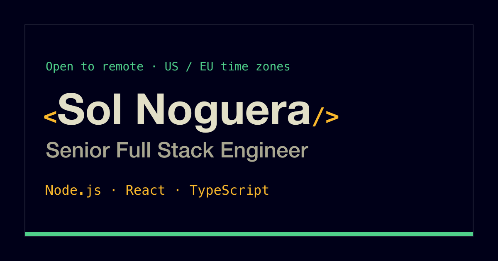

# Sol Noguera · Portfolio

Personal site of **Sol Noguera, Senior Full Stack Engineer** (Node.js · React · TypeScript).

**Live:** https://portfolio-soln.netlify.app



## Quality bar

| Check                          | Result                                                                    |
| ------------------------------ | ------------------------------------------------------------------------- |
| Lighthouse (mobile)            | Performance 95 · Accessibility 100 · Best Practices 100 · SEO 100 · CLS 0 |
| axe-core (WCAG 2.2 AA)         | 0 violations, light and dark themes, desktop and mobile                   |
| Heaviest image                 | 95 KB (down from 6.5 MB)                                                  |
| Third-party scripts at runtime | none                                                                      |

All of these run in CI on every pull request.

## Stack

- **Next.js (App Router) + TypeScript (strict)**, statically exported (`output: "export"`): every page is plain HTML on a CDN, with no server to run.
- **Tailwind CSS v4** with design tokens as CSS variables. Every color pair is checked for WCAG AA contrast in both themes.
- **Vitest + Testing Library** for unit and component tests; **Playwright + @axe-core/playwright** for end-to-end and accessibility tests.
- **GitHub Actions**: format → lint → typecheck → unit tests → build → e2e + axe → Lighthouse budgets.
- **Netlify** hosting with security headers (CSP, HSTS, nosniff, Referrer-Policy, Permissions-Policy) and immutable caching for hashed assets.

## Architecture decisions

- **Content separated from UI.** Everything shown on the site lives in typed modules under `src/content/` (`profile`, `experience`, `projects`, `skills`). Updating the CV means editing data, not components.
- **Server Components by default.** Only the header (active section, mobile menu), the theme toggle and the contact form ship client JavaScript.
- **No theme flash.** A tiny inline script sets `data-theme` before first paint (saved choice → OS preference). React reads it with `useSyncExternalStore`, so there's no hydration mismatch.
- **Native platform over libraries.** The mobile menu is a `<dialog>` opened with `showModal()`, which provides the focus trap, `Esc` to close and an inert background for free. Smooth scrolling is CSS and respects `prefers-reduced-motion`. Icons are inline SVG.
- **Accessible contact form.** Visible labels, inline errors linked through `aria-describedby`, focus moves to the first invalid field, a live region announces success or failure (with an email fallback) and a honeypot field filters spam. It submits with `fetch` to Getform, so the visitor never leaves the page.
- **SEO.** Real metadata, Open Graph/Twitter cards, canonical URL, `sitemap.xml`, `robots.txt`, a web manifest and `Person` JSON-LD.

## Getting started

Requires Node.js 22.

```bash
npm install
npm run dev          # http://localhost:3000
```

| Script                       | What it does                                    |
| ---------------------------- | ----------------------------------------------- |
| `npm run build`              | Static export to `out/`                         |
| `npm run preview`            | Serve `out/` locally                            |
| `npm run lint` / `typecheck` | ESLint (Next + full jsx-a11y) / `tsc --noEmit`  |
| `npm test`                   | Unit and component tests (Vitest)               |
| `npm run test:e2e`           | Playwright + axe against the built site         |
| `npm run images -- <dir>`    | Re-generate optimized WebP images and app icons |
| `npm run og`                 | Re-generate the 1200×630 social preview         |

### Environment

| Variable                    | Default                 | Purpose                  |
| --------------------------- | ----------------------- | ------------------------ |
| `NEXT_PUBLIC_FORM_ENDPOINT` | the site's Getform form | Contact form POST target |

## Project structure

```
src/
  app/            layout (metadata, fonts, theme script), page, sitemap/robots/manifest, icons
  components/
    layout/       Header (nav + mobile dialog), Footer
    sections/     Hero, Impact, Experience, Projects, Skills, About, Contact
    ui/           Button, ExternalLink, Icon, SectionHeading, Tag, ThemeToggle, SkipLink
  content/        typed site content
  lib/            theme, contact form logic, active-section hook
e2e/              Playwright specs (a11y, site, mobile menu)
scripts/          image optimization and OG image generation
```
